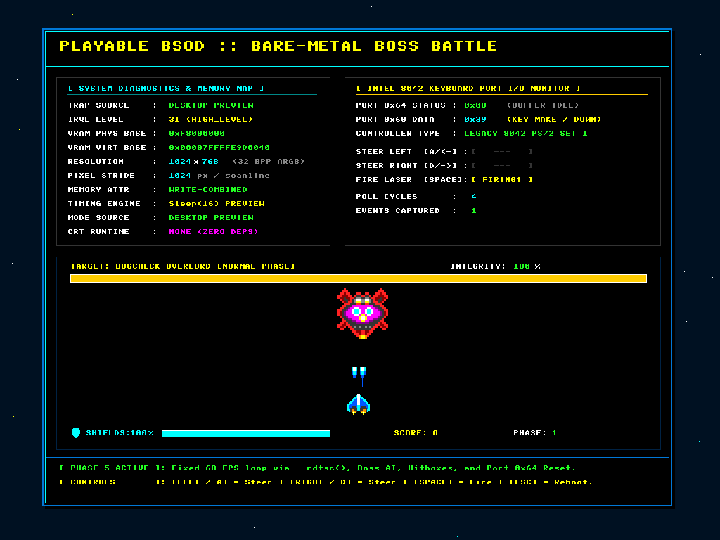
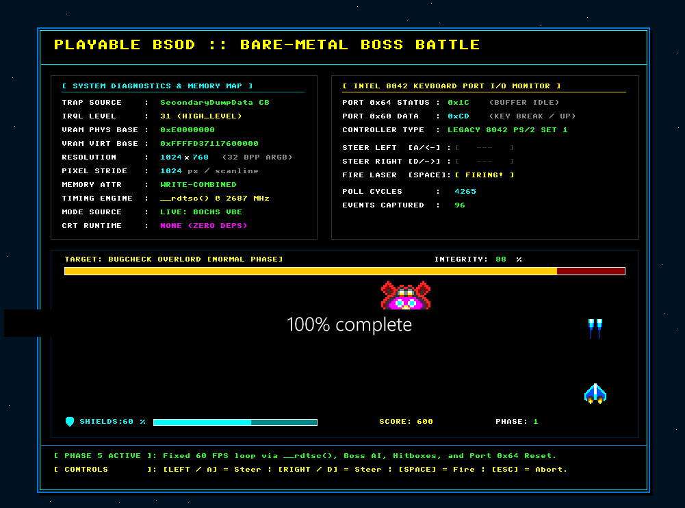
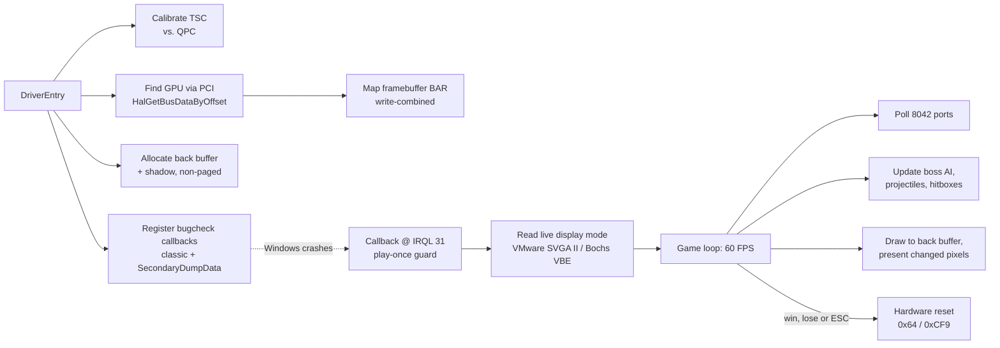

# Playable BSOD 💀🎮

**A Windows kernel driver that turns the Blue Screen of Death into a boss fight.**

When Windows crashes, `playable_bsod.sys` takes over the screen from inside the bugcheck and runs a 60 FPS arcade shooter: no OS, no drivers, no interrupts. Just raw video memory, the keyboard controller's I/O ports and the CPU's cycle counter, at **IRQL 31**, the moment after the kernel has given up.

Beat the *BugCheck Overlord* and the machine reboots itself. Lose, and it reboots anyway. It was always going to reboot.

<p align="center">
  <br>
  <sub>Gameplay rendered by the same engine code in the desktop preview build, with a scripted pilot.</sub>
</p>

<p align="center">
  <br>
  <sub>The real thing: a Windows 11 VM in VirtualBox after <code>NotMyFault crash 1</code>. You can see Windows' own
  <i>"100% complete"</i> crash-dump text bleeding through: the game runs <i>inside</i> the dump process.</sub>
</p>

> [!CAUTION]
> This is a kernel driver that runs during a system crash. **Only use it in a virtual machine you don't mind crashing.** It requires test-signing mode, installs a self-signed test certificate as a trusted root in the VM, and is not meant for real hardware.

---

## Why is this hard?

By the time a bugcheck callback runs, nearly everything a program normally relies on is gone:

| Normally you'd use… | …but during a bugcheck | So instead the driver… |
| :--- | :--- | :--- |
| The display driver / DirectX | WDDM has stopped | writes pixels straight into the GPU's **physical framebuffer**, mapped write-combined at load time |
| Keyboard driver / USB HID stack | Interrupts are off at IRQL 31 | polls the legacy **Intel 8042** keyboard controller on ports `0x60`/`0x64` and decodes PS/2 Scan Code Set 1 |
| Timers, `Sleep`, threads | The scheduler is dead | spins on **`__rdtsc()`**, calibrated against the performance counter when the driver loads |
| `malloc` / pool allocations | Allocating is illegal at HIGH_LEVEL | uses buffers **pre-allocated from non-paged pool** at load time, and zero allocations during the crash |
| Page faults | A page fault here is fatal | keeps every code path and buffer **non-paged** |
| `ExitProcess`, a nice shutdown | The machine cannot resume | pulses the CPU reset line via the **8042 (`0xFE`)** or the **PCI reset register `0xCF9`** |

## How it works



A few of the more interesting details:

- **Two hooks, one game.** The driver registers both a classic `KeRegisterBugCheckCallback` routine, which runs on every bugcheck, and a `KbCallbackSecondaryDumpData` reason callback, which runs while the crash dump is being written. An interlocked guard makes sure only the first one to fire plays. The panel shows which one it was.
- **The screen mode is read at crash time.** Users resize VM windows after the driver loads, so the driver asks the virtual GPU directly, through the **VMware SVGA II** registers (VMware, VirtualBox VMSVGA) or the **Bochs VBE** DISPI registers (QEMU std-vga, VirtualBox). If neither answers, it falls back to the resolution the install script recorded from WMI. Everything is drawn on a 1024×768 logical canvas that's centred on whatever the real resolution is.
- **Dirty-pixel presentation.** Every frame is drawn into a RAM back buffer. A shadow copy tracks what's already on screen, so only changed pixels are written to video memory: about **16 KB per frame instead of about 1.4 MB, 82× less**. That matters in VMs, where the hypervisor tracks every framebuffer write.
- **The PS/2 mouse can't fake keystrokes.** Mouse packets share the 8042's output buffer, and a stray `0x01` byte is the ESC scancode. Bytes flagged as AUX (status bit 5) are discarded.
- **No CRT, no floating point.** All drawing (8×8 bitmap font, Bresenham lines, alpha-tested sprites, number formatting) is hand-written integer code.

More detail in [`docs/ARCHITECTURE.md`](docs/ARCHITECTURE.md).

## Controls

| Key | Action |
| :--- | :--- |
| `←` `→` / `A` `D` | Steer |
| `Space` | Fire twin lasers |
| `Esc` | Abort and reboot |

The boss enrages at 50% integrity: it moves faster and switches to a 3-way spread attack.

## Try it

### Requirements
- **Host:** Windows 10/11 with Visual Studio 2022 (MSVC v143) and the **Windows Driver Kit** (tested with WDK 10.0.26100). Python is optional (used to serve files to the VM).
- **Guest VM:** Windows 10/11 x64 on **VirtualBox** (tested), VMware or QEMU (expected to work, untested). The VM needs a PS/2 keyboard, which those all emulate.
  ⚠️ **Hyper-V Gen 2 won't work.** It has no 8042 keyboard controller, so the game can't read input.
- [**NotMyFault**](https://learn.microsoft.com/sysinternals/downloads/notmyfault) from Sysinternals, to trigger the crash. Put `notmyfaultc64.exe` in `dist\`.

### 1. Prepare the VM (once)
In the VM, from an elevated PowerShell:
```powershell
.\vm\setup_vm.ps1     # enables test signing, disables auto-reboot; then restart the VM
```

### 2. Build, sign and serve (host)
Double-click **`prepare_vm_drop.bat`**. It:
1. builds `playable_bsod.sys` (`build.bat`),
2. signs it with a self-signed `CN=PlayableBSOD Test` certificate, creating one in your user store on first run (`tools\sign_and_stage.ps1`),
3. stages everything in `dist\`, and
4. serves `dist\` on port 8000, printing the exact command to run in the VM.

### 3. Install and crash (VM)
In an **admin** Command Prompt in the VM, run the command the host printed. It looks like this:
```bat
cd %TEMP% && curl -fO http://<host-ip>:8000/run.bat && run.bat <host-ip>:8000
```
That installs the certificate, records the display mode and starts the driver. Then:
```bat
notmyfaultc64.exe /accepteula crash 1
```
Click into the VM window so it has keyboard focus, and fight.

Prefer copying files by hand? Put the contents of `dist\` in the VM and run `dist\setup_and_start.bat` as administrator instead.

### Desktop preview (no VM, no crash)
The same rendering and game code also builds as a normal Win32 app:
```bat
preview.bat                        :: play in a window at 1024x768
preview.bat --res 1920x1080        :: check the layout at another resolution
preview.bat --bmp-only             :: render one frame to playable_bsod_preview.bmp
```

## Project layout

```
src/
  driver.c        Driver entry/unload, PCI discovery, framebuffer mapping, live mode
                  detection, TSC calibration, bugcheck callbacks, game loop, HUD
  driver.h        Framebuffer + driver context types
  rasterizer.h    Software renderer: primitives, 8x8 font, sprites, back buffer + present
  input.h         8042 polling, Scan Code Set 1 state machine (Win32 path for the preview)
  game.h          Game state, boss AI, projectiles, collisions, hardware reset
tools/
  preview.c             Desktop preview host
  sign_and_stage.ps1    Test-signing + file server used by prepare_vm_drop.bat
dist/             VM-side install scripts (run.bat, setup_and_start.bat)
vm/setup_vm.ps1   One-time guest configuration
docs/             Architecture notes, roadmap, progress log, images
```

## Limitations

- **x64 Windows only;** 32-bpp linear framebuffers only.
- **PS/2 input only.** On real hardware with a USB keyboard there's usually no 8042 (or it's emulated by firmware only until the OS takes over), so the game can't read keys. The panel shows `NO 8042 FOUND!`.
- Display modes larger than the mapped region (8 MiB by default, which covers 1920×1080) are clipped. Set the `FramebufferSize` registry value to map more.
- Exercised so far on VirtualBox with a Windows 11 guest. Reports from VMware and QEMU are welcome.

## License

[MIT](LICENSE) © 2026 Krish Pandey. NotMyFault is © Microsoft Sysinternals and isn't included in this repository.
